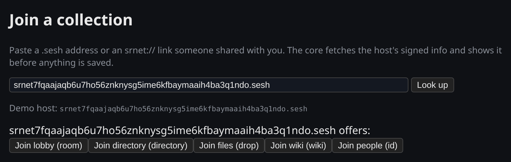
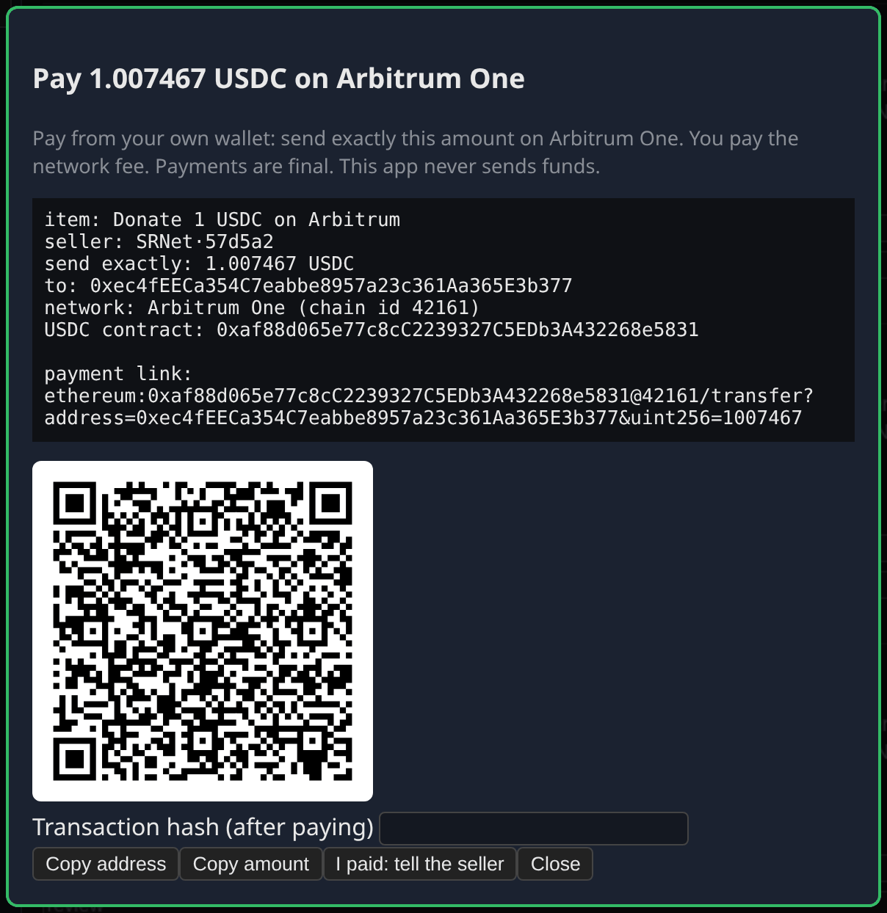
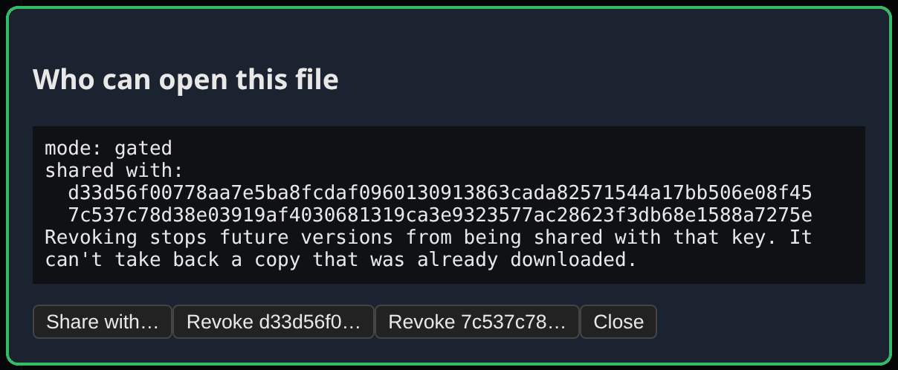
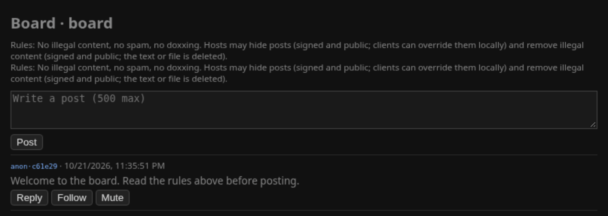
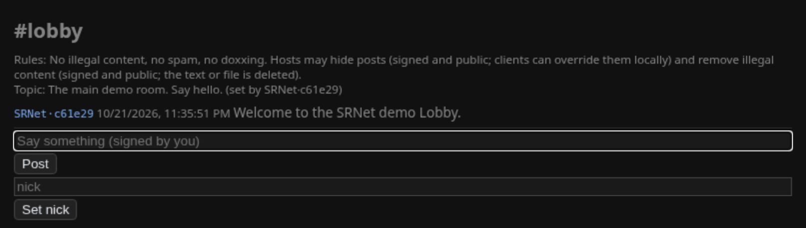
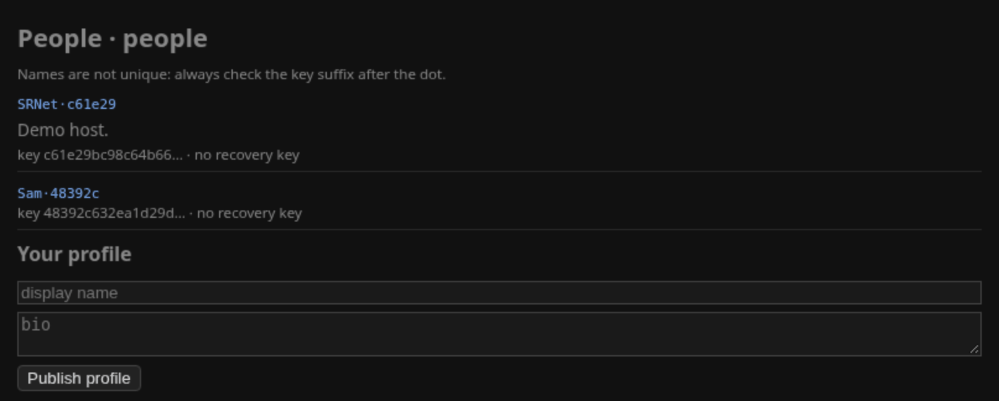
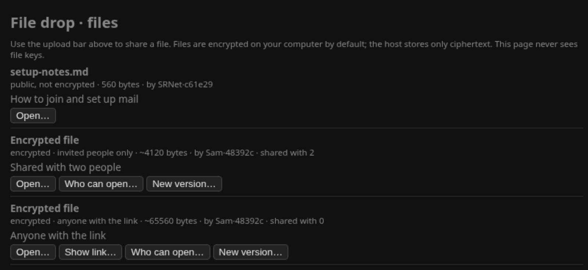
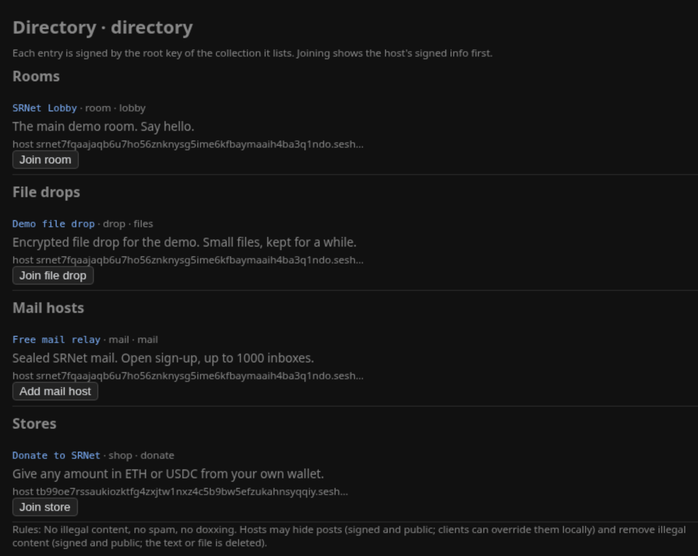
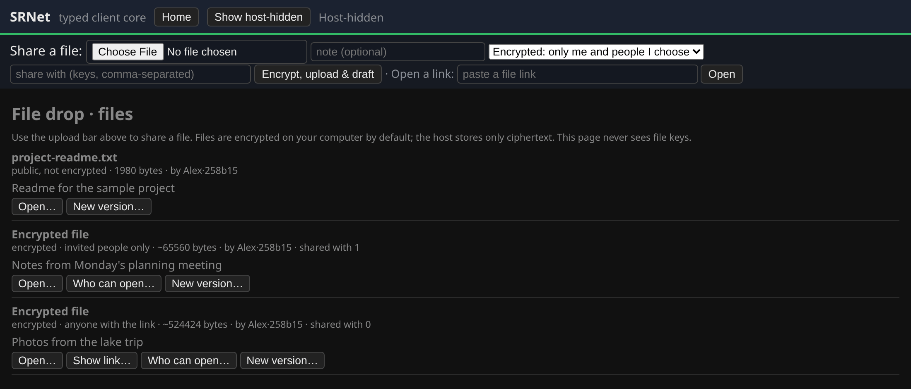

# SRNet client (v0.2 Beta)

<table>
<tr><td align="center"><br>Join a collection</td><td align="center"><br>Paying a shop</td></tr>
<tr><td align="center"><br>Sharing an encrypted file</td><td align="center"><br>Wiki history</td></tr>
</table>

**What's new**

- No developer fee anywhere in SRNet.
- Simpler payments: you pay the seller straight from your own wallet. No balance to top up, no
  contract and no escrow.
- Exits are a separate add-on in their own repository, and this client works without them.

Full history: [CHANGELOG.md](CHANGELOG.md)

SRNet is one app for chat rooms, message boards, wikis, mail, private files and small shops. It
runs on Session Router, a private network where every site has a `.sesh` address.

- **SNApps.** Boards, chat rooms, wikis, storefronts, file drops, profiles and plain `.sesh`
  web pages. Hosts only store signed data; the app on your computer shows it and checks every
  signature.
- **Mail.** Mail is encrypted on your computer before it's sent. The hosts that hold it until
  the recipient comes online can't read it or see who sent it.
- **Private files.** Files are encrypted on your computer before upload. Share them with chosen
  people, with anyone who has the link, or publish them unencrypted.
- **Shops.** A storefront shows each item's price with a payment address, the exact amount and
  a QR code. You pay from your own wallet; the app never holds money.
- **Exits (add-on).** Buy time on an exit and send your internet traffic through it, like a VPN.
  This is a separate add-on, `srnet-exits`, from
  [SRNet-VPSHost-ExitPack](https://github.com/SRNet-lab/SRNet-VPSHost-ExitPack).

SRNet is beta software.

SRNet is an independent project. It is not affiliated with or endorsed by the Session Foundation
or the Session Technology Foundation.

## Install

These steps are for Ubuntu 24.04 desktop (amd64). Open a terminal and run each block in order.
Each block starts in your home folder. We recommend a dedicated machine or drive for SRNet.

macOS works for SNApps, mail and files, but not for exits. Windows is not supported in this
release.

### 1. Session Router

Session Router carries all `.sesh` traffic. This installs the SRNet build of `session-router-client`, which adds the exit map
(source: [Session-Router-SRNet](https://github.com/SRNet-lab/Session-Router-SRNet), branch
`srnet/mapexit-dev`).

```sh
cd ~
sudo apt update
sudo apt install -y curl ca-certificates
sudo curl -fsSLo /usr/share/keyrings/session-foundation.gpg https://deb.session.foundation/pub.gpg
echo "deb [signed-by=/usr/share/keyrings/session-foundation.gpg] https://deb.session.foundation $(. /etc/os-release; echo $VERSION_CODENAME) main" | sudo tee /etc/apt/sources.list.d/session-foundation.list
sudo apt update
cd /tmp
curl -fLO https://github.com/SRNet-lab/Session-Router-SRNet/releases/download/v1.1.0-srnet6/session-router-srnet_1.1.0+srnet6_amd64.deb
echo "5c1c9b553b25649657f9f8e3ae0431aa3fe0534c82e65214588c728307bf3237  session-router-srnet_1.1.0+srnet6_amd64.deb" | sha256sum -c \
  && echo "checksum OK" \
  && sudo apt install -y ./session-router-srnet_1.1.0+srnet6_amd64.deb session-router-client \
  && sudo apt-mark hold session-router-srnet session-router-client
cd ~
```

You should see `checksum OK` before apt starts. If you don't, nothing was installed: download it
again and rerun the lines from `curl -fLO` down. Session Router starts now and at every boot.

### 2. `.sesh` names

This tells Ubuntu to send `.sesh` names to Session Router:

```sh
cd ~
sudo mkdir -p /etc/systemd/system/session-router-client.service.d
printf '[Service]\nExecStartPost=+/bin/sh -c "sleep 3; resolvectl dns sr-tun0 127.3.2.1; resolvectl domain sr-tun0 ~sesh ~snode; resolvectl default-route sr-tun0 false"\n' | sudo tee /etc/systemd/system/session-router-client.service.d/dns.conf
sudo systemctl daemon-reload
sudo systemctl restart session-router-client
grep -q '^nameserver 127.0.0.53' /etc/resolv.conf || sudo ln -sf /run/systemd/resolve/stub-resolv.conf /etc/resolv.conf
```

The last line only matters on some cloud and VPS images, which ship their own DNS settings.
Other names are not affected. Check that it works:

```sh
getent hosts localhost.sesh   # prints an address starting with fd2e:
```

### 3. The SRNet app

```sh
cd ~
sudo apt install -y git python3-venv nftables
git clone https://github.com/SRNet-lab/SRNet-Desktop.git
cd SRNet-Desktop
./install.sh --with-exits      # or plain ./install.sh if you don't want exits
export PATH="$HOME/.local/bin:$PATH"
cd ~
```

With `--with-exits` it asks for your password once, to set up Session Router for exits. The
`export PATH` line is only needed in this terminal; new terminals find `srnet` by themselves.

### 4. First run

```sh
srnet doctor
srnet ui
```

`srnet doctor` checks your setup and ends with `PREFLIGHT=OK` when everything is ready. A WARN or
FAIL line is followed by a `FIX:` line that says what to do.

`srnet ui` opens the app in your browser, with the demo lobby, directory and mail host already
joined. Leave that terminal open while you use the app, and press Ctrl-C there to stop it. Use a
second terminal for other `srnet` commands. Run `srnet` as yourself, never with `sudo`.

**Rejoin the demos.** If Lobby, Directory or Files go missing from your sidebar, paste the demo host's address into the Join box on the Home page:

`srnet7fqaajaqb6u7ho56znknysg5ime6kfbaymaaih4ba3q1ndo.sesh`

### 5. Use an exit (optional)

You need a few USDC on Arbitrum One or Base in any wallet (a phone wallet works), plus a little
ETH on the same network for the network fee.

```sh
srnet exits                            # list sellers; copy a seller id
srnet buy --seller <id> --hours 1      # shows the address, exact amount and a QR code
srnet connect <id>                     # send your traffic through the exit (asks for your password)
curl -s https://api.ipify.org; echo    # prints the exit's IP address
srnet disconnect                       # back to your normal connection
```

After `buy`, send exactly the amount shown from your wallet and leave the terminal open until it
says the seller confirmed. The **Exits** tab in the app does the same with buttons. More in the
add-on's [README](https://github.com/SRNet-lab/SRNet-VPSHost-ExitPack/blob/main/client/README.md).

### Update or remove

To update:

```sh
cd ~/SRNet-Desktop && git pull && ./install.sh
```

Your settings in `~/.srnet` are kept, and the exits add-on updates with it.

`~/SRNet-Desktop/install.sh --uninstall` removes the app and keeps your settings in `~/.srnet`.

To stop Session Router from starting at boot: `sudo systemctl disable session-router-client`.
Start it yourself with `sudo systemctl start session-router-client`.

## Using the app

### SNApp templates

<table>
<tr><td align="center"><br>Board</td><td align="center"><br>Chat room</td></tr>
<tr><td align="center"><br>Wiki</td><td align="center"><br>Profiles</td></tr>
<tr><td align="center"><br>Shop</td><td align="center"><br>File drop</td></tr>
<tr><td align="center"><br>Directory</td></tr>
</table>

### Joining

The app starts with Home and the collections it ships with. To join something else, paste a
`.sesh` address or an invite link (`srnet://...`) on Home. The app shows the host and what it
offers, and nothing is saved until you click **Join**. From a terminal, `srnet open '<link>'`
opens the same join sheet.

The first time you join, the app remembers the host's key. If the key changes later, the app stops
syncing that collection and asks you before trusting the new one.

### Mail

Your mail address is a `srnet://mail/...` link. Open **Mail** at the top of the sidebar to see
and share it. New installs start with one contact, **SRNet** (the team inbox).

Mail from your contacts goes to **Inbox**. Mail from anyone else goes to **Requests** until you
accept the sender. Mail hosts keep messages 7 days by default.

From the command line:

```sh
srnet mail address --name "Alice"                            # your link to share
srnet mail send 'srnet://mail/...' -s "Hello" -m "Hi Bob"
srnet mail fetch && srnet mail list && srnet mail read <id>
srnet mail hosts http://<mail host> [http://<backup host>]   # pick your own mail hosts (1 to 3)
```

### Files

File drops are run by Storage Sellers: people who host a file drop on their own server. Files are
encrypted on your computer before upload. For each file, choose:

- **Only me and people I choose** (default). You can add people later.
- **Anyone with the link.** The key is in the link, so the Storage Seller never sees it.
- **Not encrypted.** For files meant to be public.



Removing someone stops them getting future versions, not copies they already downloaded. Each
Storage Seller sets its own largest file size (25 MiB by default). In Mail, **Attach** stores the
file encrypted on a file drop you've joined and sends only the key.

**Coming soon:** Storage Sellers will be able to turn off public hosting, so they hold only
encrypted files they can't read. The app will also let you move or copy your files between
Storage Sellers and keep them on several at once.

### Shops

**Pay** shows the network, the address, the exact amount and a QR code for a phone wallet. You
pay from your own wallet and pay the network fee. Then **I paid: tell the seller** sends the
seller your order with the transaction. Real payments are USDC on Arbitrum One or Base. Payments
are final.

One payment is limited to 20 USDC by default. To change it, put
`"payments": {"max_usdc": "40"}` in `~/.srnet/client.json`.

### Moderation

Hosts can **hide** a post (your app hides it, and you can still choose to show it), **remove**
illegal content (deleted everywhere on the next sync), and **pin** up to 3 posts. Every action is
a signed, public record.

## Details

- **Command line:** `srnet ui`, `srnet doctor`, `srnet open <link>` and `srnet mail ...`. With the
  exits add-on also `srnet exits`, `buy`, `paid`, `connect`, `status`, `disconnect` and `verify`.
  See [client-cli/README.md](client-cli/README.md).
- **Encryption:** mail is signed with your key, then sealed to the recipient's key (X25519 +
  ChaCha20-Poly1305) and padded to a fixed size bucket. Files use ChaCha20-Poly1305. Wire format:
  [`snapps/docs/MAIL.md`](snapps/docs/MAIL.md).
- **Directories:** hosts list their own collection by signing a `directory.entry` with that
  collection's root key (`snapps/scripts/directory_entry.py`).
- **Old SRNet balance:** earlier versions kept USDC in an SRNet balance on Arbitrum One. That is
  gone. If you have USDC left there, the exits repository has a tool to send it back to your
  wallet until 2027-01-18:
  [contrib/legacy-cashout](https://github.com/SRNet-lab/SRNet-VPSHost-ExitPack/tree/main/contrib/legacy-cashout).

## Related repositories

- [Session-Router-SRNet](https://github.com/SRNet-lab/Session-Router-SRNet): the Session Router
  build used in the install steps above, with exit mapping added.
- [SRNet-VPSHost-ExitPack](https://github.com/SRNet-lab/SRNet-VPSHost-ExitPack): the exits
  add-on for this app, and the pack for running your own paid exit and listing it on the
  exit board.
- [SRNet-TypedSNApp-HostPack](https://github.com/SRNet-lab/SRNet-TypedSNApp-HostPack): run your
  own host for boards, stores, wikis, chat rooms, file drops, profiles, directories or mail.

## License

client-cli/ is Apache-2.0 and snapps/ is MIT. See [LICENSE](LICENSE).

## Donations

If SRNet is useful to you, donations are welcome at
`0xec4fEECa354C7eabbe8957a23c361Aa365E3b377` (USDC or ETH on Arbitrum One or Base).
